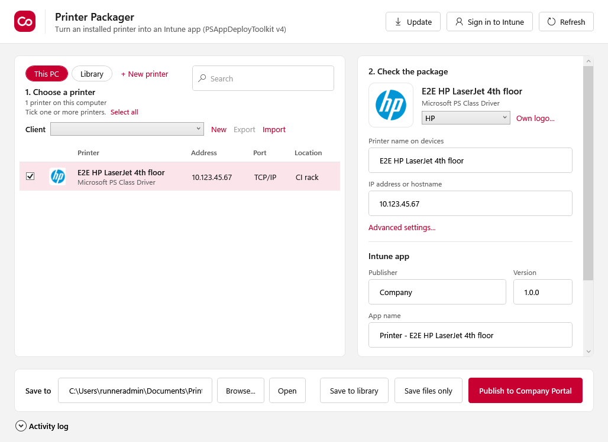

# Printer Packager

Turn a printer that is installed on your PC into an Intune app (PSAppDeployToolkit v4).



## Use it

1. Download `PrinterPackager.exe` from [Releases](../../releases/latest).
2. Put it anywhere, a network share works fine. Double click it and allow admin rights.
3. Pick the printer, check the name, IP and logo, click **Create Intune package**.

Everything for that printer ends up in one folder:

- the `.intunewin` file to upload in Intune
- `Logo.png` for the app icon
- `Detection.ps1` for the detection rule
- `Intune-Upload-Info.txt` with the install and uninstall commands
- `Package` with `Install-Printer.cmd` for a manual install (or the `.zip`)

The driver, port, printer preferences and the brand logo are included automatically.

## Notes

- PSAppDeployToolkit 4.1.8 is inside the exe.
- IntuneWinAppUtil.exe may not be redistributed, so the app downloads it from Microsoft the first time. No internet? Put `IntuneWinAppUtil.exe` next to `PrinterPackager.exe`.
- Logs on devices: `C:\Windows\Logs\Software`.
- Settings are remembered per user.

## Build

```
pwsh build/Build.ps1
```

Needs PowerShell 7 and the .NET 8 SDK. Output: `dist/PrinterPackager.exe`.

## License

MIT. Uses [PSAppDeployToolkit](https://psappdeploytoolkit.com) (LGPL 3.0).
